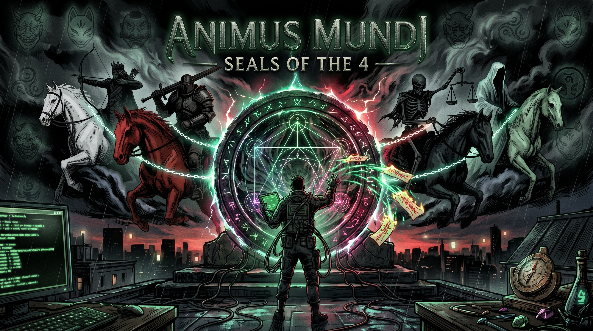

# ANIMUS MUNDI: SEALS OF THE 4

**A Cyber-Occult Terminal Simulation & Demon-Hunting Detective Game**  
*Built with React 19, TypeScript, Vite, HTML5 Canvas, and a 100% Procedural Web Audio Synth Engine.*

<div align="center">
  
</div>

---

## // WELCOME TO THE WIRE

Reality across Greater London and the Surrey Hills is tearing open at the seams. The **Four Horsemen of the Apocalypse**—**CONQUEST**, **WAR**, **FAMINE**, and **DEATH**—are bleeding into mundane geography, anchoring themselves to our world through the **72 Spirits of Solomon**.

You are a remote **Thaumaturge Operative** jacked into **Thaumaturgic OS v4.10**. From behind a phosphor-green CRT terminal, you breach haunted precincts, analyze raw supernatural telemetry, outmaneuver **Ordo Malleus** Inquisition strike teams, bind Japanese Shikigami daemons into your OS kernel, and trace geometric seals to trap ancient demons inside a Solomonic Brass Vessel.

No hand-holding. No quest markers. Just raw forensic clues, a command line, and a ticking clock before reality unravels.

---

## // THE CORE LOOP: INFILTRATE, TRIANGULATE, BIND

Every compromised sector is a procedurally laid-out tactical sub-grid (5–8 rooms) haunted by one of the 72 Goetian lieutenants. You drop in outside at the **Perimeter Tether** with every door locked—and work your way in:

1. **Breach the Threshold:** Recon adjacent rooms with `scan` (alias `probe`) and move in with `enter` (aliases `breach`, `move`). Every ward you break spikes **Inquisition Heat**, and walking into a Malleus Witch-Hound patrol costs Humanity — run `decoy` on a patrolled room first.
2. **Read Symptoms, Not Prompts:** Rooms can be trapped with one of four hazards (Aethyric Static, Malleus Laser Tripwire, Brimstone Miasma, Blood-Hex Ward). The OS only reports the *physical symptom*—you have to deduce the right counter-command (`degauss`, `bypass`, `purge`/`purify`, `dispel`) or eat a nasty feedback shock.
3. **Active Forensic Triangulation:** Clues aren't handed out for free. Anomalous rooms emit undecoded signals on one of three channels. Match your forensic tool to the room's sensory anomaly to decode the evidence:
   * `vox` — **EVP / Spectrogram Filter** (whispers, infrasound tremors, raptor shrieks, lupine howls)
   * `assay` (alias `reagent`) — **Alchemical Assay** (amphibian slime, rapid rust, transmuted metals, plague spores, arterial frenzy)
   * `auspex` (aliases `lidar`, `lens`) — **Astral / Thermal Sensor** (light refraction, $-18^\circ\text{C}$ cryo-stasis, $1,200^\circ\text{C}$ scorching, dead scripts, star drift, backward clocks)
4. **Build the Case:** Field readings are rarely clean — most come back **degraded**, narrowing a clue to two or three possible phenomena. Resolve them with `refine` (costs Humanity and Heat) or reason around them using other evidence:
   * **Witness statements** — `interview` the sector's civilian witness for a partly redacted account of what they saw, then compare it with the Lemegeton entries in the Codex.
   * **Anchor resonance** — `attune` at the **[ANCHOR]** chamber to learn which Horseman's court the demon serves (plus a +4s sealing bonus). Attune again for a costly deep reading of its rank.
   * The **Codex** ranks all 72 suspects by how well they fit your evidence and rules out the ones that contradict it — the final call is yours, and a wrong True Name burns your catalysts.
5. **Synthesize & Seal:** Transmute raw salvage (`Scrap Metal`, `Cursed Earth`, `Alchemical Distillate`) into planetary Solomonic metals (`Gold Leaf`, `Silver Shavings`, `Copper Wire`, `Quicksilver Drops`, `Sacred Sand`, `Cold Iron Filings`, `Lead Weights`), type the demon's True Name, and trace its binding geometry before the connection collapses.
6. **Trigger Resonance Cascades:** The Ars Goetia is a feudal hierarchy. Sealing a high-ranking **King**, **Prince**, or **Duke** sends a shockwave through their legion, automatically collapsing **1 to 2 lesser vassals** of that Horseman's court straight into your Brass Vessel.

7. **Read the Conditions:** Sectors can roll conditions that change how they play — **Malleus Surveillance** (+50% Heat), **Hallowed Ground** (-40% Heat), **Aethyric Storm** (every reading degraded), **Lucid Witness** (far less redaction) or **Heavily Warded** (every room trapped).

---

## // THE 7 VIEWPORTS (`F1` – `F7`)

Switch instantaneously across seven specialized OS screens via function keys or the top tactical bar:

* **`[F1] FIELD_OPS` — Tactical Sub-Grid, Regional Map & TTY1 Console:** Zoom and pan across 16 interconnected sectors from Caterham and Croydon up to Highgate and St. Paul's Cathedral. Monitor live room symptoms, waveform spikes, and execute field directives.
* **`[F2] CODEX` — Goetian Deduction Engine:** Filter all 72 spirits of the *Lemegeton* by Horseman allegiance and observed manifestation signs, inspect glitched/obscured demon sigils, and initiate the **Vessel Sealing Protocol**.
* **`[F3] KAGE` — Kage-no-Sho (Shikigami Kernel Interceptors):** Forge pacts with up to **2 Yokai daemons** simultaneously (`KITSUNE.SYS`, `TENGU.DMN`, `BAKU.EXE`, `ZASHIKI.BOT`, `KAMEOSA.ALC`, `KAMAITACHI.VEX`, `AMABIE.iso`, `NOPPERA.MSK`). Each spirit installs a continuous passive OS hook alongside finite active field invocations.
* **`[F4] SAFEHOUSE` — Alchemical Altar & Tether Recovery:** Craft planetary catalysts, rest at the brass-warded hearth to restore Humanity, and spend Obols to jam Ordo Malleus direction-finders across hot sectors.
* **`[F5] HORSEMEN` — Apocalypse War Room:** Track all four Riders via custom vector Apocalypse Sigils, inspect the 18 Goetian anchors tethered to each court, and launch the triple-matrix **Grand Rite of Banishment**.
* **`[F6] DOSSIER` — Operative Service Record:** View your full-body ink operative portrait, Brass Vessel ledger, `0.01%` precision Global Entropy meter, and session save controls.
* **`[F7] MANUAL` — In-Universe Field Guide:** Quick-reference field manual detailing forensic instruments, hazard symptom tables, Solomonic planetary metals, and Inquisition survival rules.

---

## // SURVIVAL METRICS & THE ORDO MALLEUS

* **Humanity (`0%–100%`):** Your remote mental tether. Drained by Auspex probes, Inquisition ambushes, and botched hazard protocols. Restored at the Safehouse.
* **Inquisition Heat (`0%–100%`):** The Vatican-Crown **Ordo Malleus** monitors ley-line spikes with mobile tracking vans and witch-hound packs. At **75%+ Heat**, your CRT display flickers crimson with triangulation warnings. At **100% Heat**, the sector enters **Total Lockdown**—all room actions are blocked until you run `spoof` (`-15` Obols), `bribe` (`-25` Obols), invoke a stealth Shikigami, or retreat to the Safehouse.
* **Global Entropy (`0.00%` Precision):** Tracks the irreversible fraying of mundane reality. Ticks up by $+0.01\%$ to $+0.05\%$ during travel, breaches, and safehouse rest, and spikes violently if you misidentify a demon or fracture a ritual.
* **Game Over:** The run ends if Humanity hits `0%` (*Tether Severed*) or Global Entropy reaches `100%` (*Reality Unravelled*).
* **Victory:** Banish all four Horsemen to close the operation. The debrief scores your run — sectors lost, spirits left manifested, and final entropy decide whether you retire as an *Archon of the Brass Vessel* or a *Pyrrhic Survivor*.

---

## // RITUAL TRACING & PROCEDURAL WEB AUDIO

* **Pointer & Touch Sigil Tracing:** Sealing a Goetian spirit requires tracing a procedurally rotated star-polygon matrix under a tight countdown. Run out of time and the spirit **manifests** permanently: your catalysts are spent, the demon can never be sealed, and its sector is lost for the rest of the run (its neighbouring sectors still open up, so the map can't be walled off). Banishing one of the Four Horsemen escalates into a **60-second triple-matrix endurance gauntlet** where your odds scale with every lieutenant you've bound:

$$\text{Banishment Odds} = \min\Big(95\%, \; 5\% + (\text{Sealed Court Lieutenants} \times 5\%)\Big)$$

* **Zero-Asset Procedural Synth Engine (`ThaumaturgicAudio`):** Every sound in the game is synthesized live via the Web Audio API—including mechanical key clicks, radar pings, solenoid typewriter hammer strikes as each letter of a sealed demon's True Name prints out, and a sub-bass anvil impact synced with camera shake when `[SEALED]` slams onto the screen.

---

## // DUAL PLAY MODES: PURE CLI OR COMMAND PALETTE

Play the way you want on desktop or mobile:

* **`MODE: CLI`** — Pure keyboard hacker immersion. Type directives (`probe 1`, `breach 1`, `vox`, `degauss`, `spoof`, `help`) directly into the `TTY1` prompt.
* **`MODE: PALETTE`** — Unlocks a 4-tab tactical deck (`1. INFILTRATE`, `2. FORENSIC SUITE`, `3. COUNTER-HAZARDS`, `4. INQUISITION`) above the console for one-tap mouse or mobile touchscreen play, paired with responsive vertical layouts and touch-drag map panning.

---

## // RUNNING LOCALLY & DEPLOYMENT

### Local Development

```bash
git clone https://github.com/virreck/animus-mundi-core.git
cd animus-mundi-core
npm install
npm run dev
```

Open `http://localhost:5173` in your browser.

### Production Build (Netlify / Static Hosting)

* **Build Command:** `npm run build` (or `npx vite build`)
* **Publish Directory:** `dist`

### Content Scaffolding Scripts

The raw lists in `data_ingest/` can be turned into JSON scaffolds with:

```bash
npm run parse:goetia   # data_ingest/00_Manifest.txt -> data_ingest/generated/goetia.json
npm run parse:yokai    # data_ingest/01_Yokai.txt    -> data_ingest/generated/yokai.json
```

These never touch the hand-curated `src/content/*/index.ts` files; copy across anything you need by hand.
